# 거상스테이션 2.1 사용자 설명서

**2.1.1 기준**으로 작성한 설명서입니다. 처음 사용한다면 **계정 추가 → 게임 설치 경로 지정 → 필요 시 다클라 생성 → 계정 선택 → 게임 실행** 순서로 설정하세요.

이미 거상이 설치되어 있다면 다시 설치할 필요 없이 기존 설치 경로만 지정하면 됩니다.

## 목차

1. [화면 구성](#화면-구성)
2. [계정 추가와 관리](#계정-추가와-관리)
3. [게임 설치 및 경로 지정](#게임-설치-및-경로-지정)
4. [다클라 생성](#다클라-생성)
5. [계정 프리셋과 게임 실행](#계정-프리셋과-게임-실행)
6. [게임 패치](#게임-패치)
7. [브라우저와 즐겨찾기](#브라우저와-즐겨찾기)
8. [일반 설정](#일반-설정)
9. [알림 설정](#알림-설정)
10. [모양 설정](#모양-설정)
11. [브라우저 설정](#브라우저-설정)
12. [부가기능](#부가기능)
13. [문제 해결과 도움말](#문제-해결과-도움말)

## 화면 구성

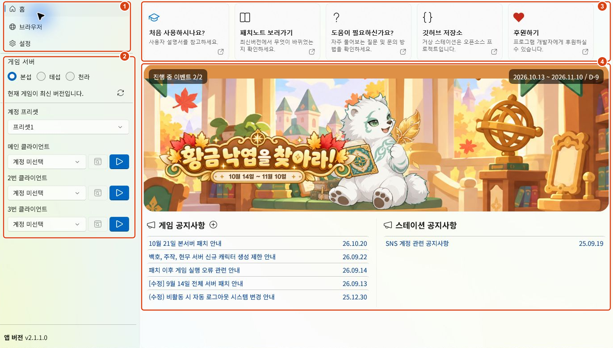

| 번호 | 영역 | 할 수 있는 일 |
| --- | --- | --- |
| 1 | 홈·브라우저·설정 | 왼쪽 메뉴로 페이지를 이동합니다. |
| 2 | 게임 실행 영역 | 서버, 계정 프리셋, 실행할 계정을 선택합니다. 브라우저 페이지에서도 사용할 수 있습니다. |
| 3 | 안내 타일 | 사용자 설명서, 앱 패치노트, 도움말 등을 엽니다. 타일이 모두 보이지 않으면 가로로 스크롤하세요. |
| 4 | 이벤트·공지사항 | 이벤트 배너나 공지 제목을 누르면 앱의 브라우저에서 해당 내용을 확인할 수 있습니다. |

## 계정 추가와 관리

**설정 → 계정**으로 이동하세요.

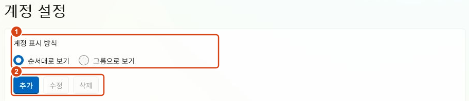

- **1 — 계정 표시 방식:** 순서대로 보거나, 입력한 그룹별로 모아 볼 수 있습니다.
- **2 — 계정 관리:** 새 계정을 추가하거나 선택한 계정을 수정·삭제합니다.

### 계정 추가

**추가**를 누르면 오른쪽에 계정 입력 패널이 열립니다.

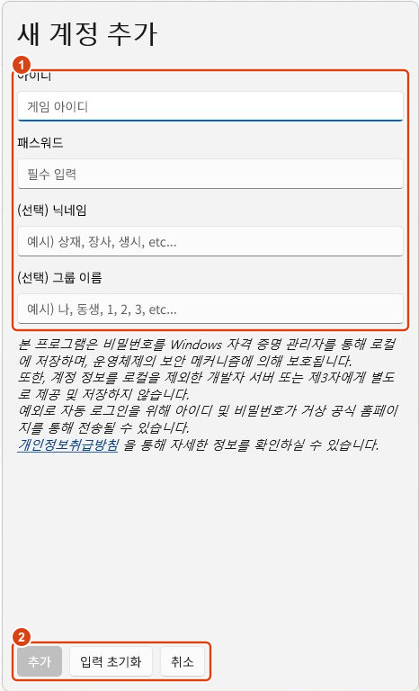

1. **아이디·패스워드**에 거상 홈페이지에서 사용하는 로그인 정보를 입력하세요.
2. 필요하면 **닉네임**과 **그룹 이름**을 입력하세요. 두 항목은 선택 사항입니다.
3. 아래의 **추가** 버튼을 눌러 저장하세요. 계정이 여러 개라면 이 과정을 반복하면 됩니다.

닉네임에는 ‘상재’, ‘장사’처럼 구별하기 쉬운 이름을, 그룹에는 ‘본계정’, ‘생산시설’처럼 함께 관리할 이름을 사용할 수 있습니다.

SNS 계정을 사용한다면 [SNS 계정 관련 공지사항](https://github.com/byungmeo/GersangStation/discussions/59)을 먼저 확인하세요.

### 수정·삭제와 순서 변경

- 계정을 선택한 뒤 **수정**을 누르거나, 계정 항목을 **더블클릭**하면 편집 패널이 열립니다.
- 비밀번호는 변경이 필요할 때만 **패스워드도 변경**을 선택하여 입력하세요. 편집 후에는 **수정 저장**을 누르세요.
- **삭제**는 확인 후 진행됩니다. 앱에 저장한 계정과 비밀번호를 지우는 기능이며, 거상 회원 탈퇴 기능은 아닙니다.
- 계정 목록의 빈 곳을 **우클릭**하면 추가 메뉴가, 계정 항목을 우클릭하면 추가·수정·삭제 메뉴가 나타납니다.
- 순서대로 보기에서는 항목을 끌어 계정 순서를 바꿀 수 있습니다. 그룹으로 보기에서는 그룹의 위·아래 이동 버튼으로 그룹 순서를 바꿀 수 있습니다.

계정 입력 패널에서 작성한 내용은 **추가 / 수정 저장**을 눌러야 저장됩니다.

## 게임 설치 및 경로 지정

**설정 → 게임 설치 및 경로 지정**으로 이동하세요. 기존 게임의 경로 지정과 새 게임 설치를 한 페이지에서 할 수 있습니다.

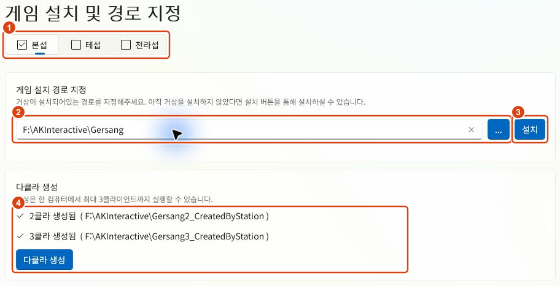

| 번호 | 항목 | 사용 방법 |
| --- | --- | --- |
| 1 | 서버 선택 | 본섭·테섭·천라섭 중 설정할 서버를 선택합니다. 서버별로 설치 경로를 지정합니다. |
| 2 | 게임 설치 경로 지정 | 이미 설치된 게임 폴더를 입력하거나, **…** 버튼으로 선택합니다. |
| 3 | 설치 | 게임을 새로 설치할 때 사용합니다. 설치할 상위 폴더를 새로 선택한 뒤 설치가 시작됩니다. |
| 4 | 다클라 생성 | 2·3클라의 생성 상태와 경로를 확인하고, 두 클라이언트를 함께 생성합니다. |

### 이미 거상이 설치되어 있다면

1. 설정할 서버를 선택하세요.
2. **…** 버튼을 누르고 해당 서버의 게임이 설치된 폴더를 선택하세요.
3. 입력란에 올바른 게임 경로가 표시되는지 확인하세요.

예를 들어 본섭의 기본 설치 폴더는 **C:\AKInteractive\Gersang**입니다. 상위의 AKInteractive 폴더가 아니라 **Run.exe가 들어 있는 실제 게임 폴더**를 선택하세요.

경로 변경은 자동으로 저장됩니다. 별도의 저장 버튼은 없습니다. 잘못된 경로라면 입력란 아래에 표시되는 안내를 확인하세요.

### 게임을 새로 설치하려면

1. 설정할 서버를 선택한 뒤 **설치**를 누르세요.
2. 게임을 설치할 **상위 폴더**를 선택하세요.
3. 다운로드와 압축 해제가 끝날 때까지 기다리세요.

상위 폴더로 **D:\**를 선택했다면 실제 설치 위치는 다음과 같습니다.

| 서버 | 최종 설치 경로 예시 |
| --- | --- |
| 본섭 | D:\AKInteractive\Gersang |
| 테섭 | D:\AKInteractive\GerTest |
| 천라섭 | D:\AKInteractive\CheonRa |

설치가 완료되면 **최종 게임 경로가 입력란에 반영되고 자동 저장**됩니다. 기존 게임 경로를 보여 주는 입력란은 새 설치 위치를 정하는 용도가 아닙니다.

설치 중에는 화면 아래에 진행 상태가 표시됩니다. 중단하려면 진행 막대 오른쪽의 **×** 버튼을 누르세요.

> 2.1.1의 게임 설치·패치·다클라 생성은 앱을 관리자 권한으로 실행하는 것을 전제로 하지 않습니다. 선택한 폴더에 쓰기 권한이 없어 작업이 실패한다면, 현재 사용자에게 쓰기 권한이 있는 설치 위치를 이용하세요.

## 다클라 생성

게임 설치 경로를 먼저 지정한 뒤, 같은 페이지의 **다클라 생성**을 누르세요. 위 이미지의 **4번 영역**입니다.

- 버튼 한 번으로 **2클라와 3클라를 함께 생성**합니다.
- 각 항목에 **‘2클라 생성됨’ / ‘3클라 생성됨’**과 실제 경로가 표시되는지 확인하세요.
- 생성 위치는 메인 게임 폴더를 기준으로 고정됩니다. 별도로 2·3클라 경로를 입력하지 않습니다.

본섭이 **D:\AKInteractive\Gersang**에 설치되어 있다면 다음 위치를 사용합니다.

| 클라이언트 | 폴더 |
| --- | --- |
| 메인 | D:\AKInteractive\Gersang |
| 2클라 | D:\AKInteractive\Gersang2_CreatedByStation |
| 3클라 | D:\AKInteractive\Gersang3_CreatedByStation |

다클라는 메인 게임의 일부 폴더를 공유합니다. 2.1.1부터는 이 연결에 **정션**을 사용하며, 로컬 NTFS 드라이브가 필요합니다. 다클라를 다시 생성할 때도 기존 다클라의 게임 설정은 유지합니다.

게임 폴더를 다른 위치로 옮겼다면 메인 설치 경로를 다시 지정한 뒤 다클라를 다시 생성하세요.

## 계정 프리셋과 게임 실행

설정을 마쳤다면 왼쪽 위의 **설정 나가기**를 눌러 홈으로 돌아오세요.

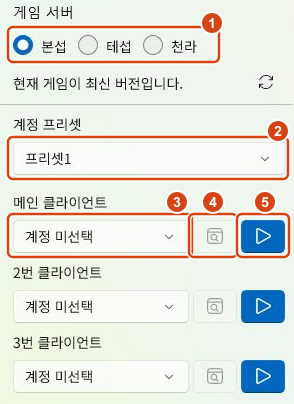

1. **서버**를 선택하세요.
2. 사용할 **계정 프리셋**을 선택하세요.
3. 메인·2번·3번 클라이언트에서 사용할 **계정**을 각각 선택하세요.
4. 홈페이지에 로그인해서 웹페이지를 보고 싶다면 계정 오른쪽의 **브라우저 버튼**을 누르세요.
5. 게임을 켜려면 맨 오른쪽의 **▶ 실행 버튼**을 누르세요.

### 계정 프리셋

**프리셋1~프리셋4**에 자주 사용하는 계정 조합을 저장할 수 있습니다. 프리셋을 고른 뒤 각 클라이언트의 계정을 선택하면 자동 저장됩니다.

예를 들어 프리셋1에는 평소 플레이하는 계정들을, 프리셋2에는 생산시설용 계정들을 선택해 두면 됩니다.

### 게임 실행 버튼의 상태

| 버튼 상태 | 의미 |
| --- | --- |
| ▶ 아이콘 | 게임 실행을 시작할 수 있습니다. |
| 원형 로딩 표시 | 로그인과 게임 실행을 처리하고 있습니다. 다시 누르면 진행 중인 절차를 취소합니다. |
| 실행 중 아이콘·비활성화 | 게임 실행을 확인한 상태입니다. 게임이 종료되면 다시 실행할 수 있습니다. |

취소는 이미 열린 게임을 강제로 종료하는 기능은 아닙니다. 게임 실행기가 이미 열린 상태라면 실행기나 게임 창도 함께 확인하세요.

로그인에 OTP 입력이 필요하면 표시되는 입력창의 안내를 따라 주세요. 게임 실행 과정에서 Windows의 사용자 계정 컨트롤 창이 나타날 수도 있습니다.

실행할 수 없는 경우에는 해당 실행 버튼 옆에 원인과 필요한 조치를 안내합니다. **설치 경로 설정**, **패치 하기** 등의 버튼이 표시되면 안내에 따라 진행하세요.

계정을 선택하지 않은 줄의 **브라우저 버튼은 비활성화**됩니다. 이 버튼은 홈페이지 로그인용이며, 게임 실행 버튼과는 별개입니다.

## 게임 패치

**설정 → 패치**로 이동한 뒤 패치할 서버를 선택하세요.

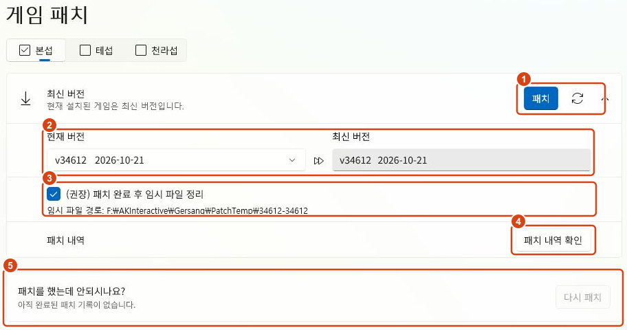

| 번호 | 항목 | 설명 |
| --- | --- | --- |
| 1 | 패치·새로고침 | **패치**로 업데이트를 시작합니다. 오른쪽 새로고침 버튼은 버전 정보를 다시 확인합니다. |
| 2 | 현재 버전·최신 버전 | 설치된 버전과 서버에서 확인한 최신 버전을 비교합니다. 평소에는 현재 버전 선택을 바꾸지 않아도 됩니다. |
| 3 | 임시 파일 정리 | 패치 완료 후 다운로드한 임시 파일을 정리합니다. 특별한 이유가 없다면 선택한 상태로 두세요. |
| 4 | 패치 내역 확인 | 해당 서버의 패치 내용을 오른쪽 패널에서 확인합니다. |
| 5 | 다시 패치 | 이전에 완료한 패치 구간을 다시 적용할 때 사용합니다. 사용할 수 있는 기록이 있을 때 활성화됩니다. |

패치 카드 오른쪽의 **꺾쇠 버튼**으로 버전 정보와 추가 항목을 펼치거나 접을 수 있습니다.

### 버전 상태 확인

- **업데이트 필요:** 설치된 게임보다 최신 버전이 있습니다. 패치를 진행하세요.
- **최신 버전:** 설치된 게임이 확인된 최신 버전 이상입니다.
- 경로나 버전을 확인하지 못했거나 너무 오래된 클라이언트라 패치할 수 없다면, 카드 상단의 안내를 따르세요. 재설치가 필요한 버전에는 관련 안내 링크가 표시됩니다.

### 다클라에도 패치가 적용되나요?

**이미 생성된 2·3클라는 자동으로 함께 패치됩니다.** 다클라 패치 적용 여부를 따로 체크하지 않습니다. 아직 만들지 않은 다클라를 패치 과정에서 새로 생성하지는 않습니다.

다클라의 단축키 등 기존 게임 설정은 유지합니다. **다클라 설정 파일 덮어쓰기 옵션은 없습니다.**

패치가 끝나면 설치된 게임의 현재 버전을 다시 확인하여 화면에 반영합니다.

### 패치 내역 확인

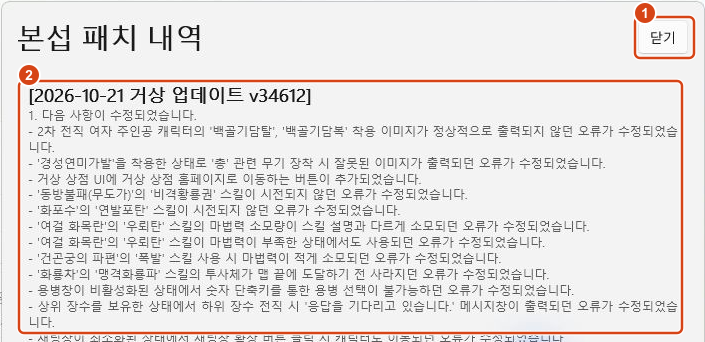

**패치 내역 확인**을 누르면 오른쪽에 패널이 열립니다. 본문을 스크롤해 내용을 확인하고, 위의 **닫기**로 닫으세요. 다른 서버를 선택하면 해당 서버의 패치 내역을 확인할 수 있습니다.

### 패치 후 게임 실행에 문제가 있다면

완료한 패치 기록이 있으면 아래 카드에 **기준 버전 → 패치 버전**이 표시됩니다. **다시 패치**는 그 구간의 패치를 다시 적용하는 기능입니다.

현재 버전 선택에서 이전 기준 버전을 골라 다시 패치할 수도 있습니다. 이는 누락되거나 잘못 적용된 파일을 다시 받기 위한 기능이며, **게임을 예전 버전으로 되돌리는 기능은 아닙니다.**

## 브라우저와 즐겨찾기

왼쪽의 **브라우저**를 누르면 앱 안에서 거상 홈페이지와 다른 웹페이지를 볼 수 있습니다.

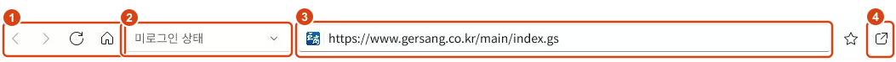

| 번호 | 항목 | 설명 |
| --- | --- | --- |
| 1 | 이동 버튼 | 뒤로·앞으로·새로고침·홈으로 이동합니다. |
| 2 | 로그인 계정 선택 | 저장한 계정을 선택해 홈페이지에 로그인합니다. |
| 3 | 주소창 | 주소를 입력하고 Enter로 이동합니다. 검색어를 입력하면 설정한 검색 엔진으로 검색합니다. |
| 4 | 외부 브라우저 열기 | 현재 페이지를 기본 웹브라우저에서 엽니다. |

주소창 왼쪽에는 사이트 아이콘이 표시됩니다. 페이지를 불러오는 중에는 원형 로딩 표시가 나타납니다. 페이지나 사이트 아이콘을 불러오지 못하면 오류 아이콘이 표시되므로, 아이콘에 마우스를 올려 안내를 확인하세요.

### 즐겨찾기 추가와 이름 변경

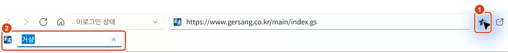

1. 원하는 페이지에서 주소창 오른쪽의 **별 버튼**을 누르세요.
2. 현재 페이지 제목으로 즐겨찾기가 추가되며, 이름을 바로 편집할 수 있습니다.
3. 이름을 바꾸거나 그대로 둔 뒤 **Enter**를 누르세요. 다른 곳을 클릭해도 편집을 마칩니다.

**Esc**를 누르면 이름 변경을 취소합니다. 방금 추가한 즐겨찾기는 기본 이름으로 남습니다.

즐겨찾기를 **우클릭 → 이름 변경**으로 나중에 수정하거나, **삭제**할 수 있습니다. 즐겨찾기에 키보드 포커스가 있을 때는 **F2**로도 이름을 바꿀 수 있습니다.

## 일반 설정

**설정 → 일반**에서 창을 최소화하거나 닫을 때의 동작을 정할 수 있습니다.

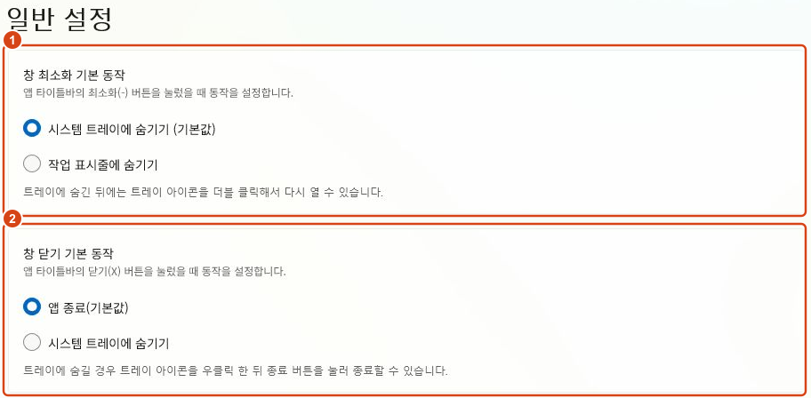

- **1 — 창 최소화 기본 동작:** 기본값은 시스템 트레이에 숨기기입니다. 작업 표시줄에 남기는 방식으로 바꿀 수 있습니다.
- **2 — 창 닫기 기본 동작:** 기본값은 앱 종료입니다. 닫기 버튼으로도 트레이에 숨기도록 바꿀 수 있습니다.

트레이에 숨긴 앱은 **트레이 아이콘을 더블클릭**하면 다시 열립니다. 앱을 완전히 종료하려면 트레이 아이콘을 우클릭한 뒤 **종료**를 선택하세요.

페이지 아래의 **윈도우 시작 자동 실행**은 Windows 로그인 시 앱을 자동으로 실행하는 설정입니다. Windows의 시작 앱 설정에서도 상태를 확인하고 변경할 수 있습니다.

## 알림 설정

**설정 → 알림**에서는 홈의 **종료 임박 이벤트 강조 표시**를 설정합니다.

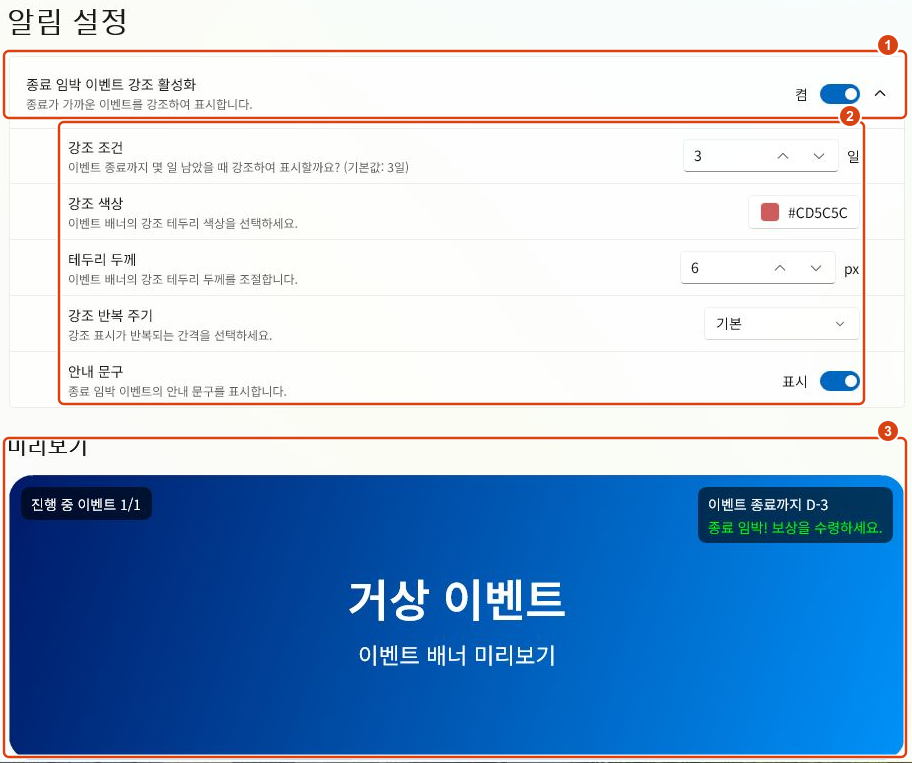

- **1 — 종료 임박 이벤트 강조 활성화:** 강조 표시를 켜거나 끕니다. 끄면 하위 설정도 비활성화됩니다.
- **2 — 강조 세부 설정:** 종료 며칠 전부터 강조할지, 테두리 색상·두께, 반복 주기를 정합니다. 안내 문구 표시 여부도 바꿀 수 있습니다.
- **3 — 미리보기:** 변경한 설정이 이벤트 배너에 어떻게 보이는지 바로 확인합니다.

강조 반복 주기는 **느리게·기본·빠르게** 중 선택할 수 있습니다. 강조를 꺼도 이벤트 배너 자체는 정상적으로 표시됩니다.

## 모양 설정

**설정 → 모양**에서 앱 테마를 선택하세요.

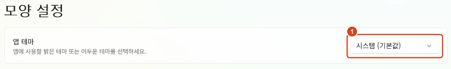

**시스템(기본값)·라이트·다크** 중에서 선택할 수 있습니다. 시스템을 선택하면 Windows의 앱 모드 설정을 따릅니다.

## 브라우저 설정

**설정 → 브라우저**에서 검색 엔진과 브라우저 데이터를 관리할 수 있습니다.

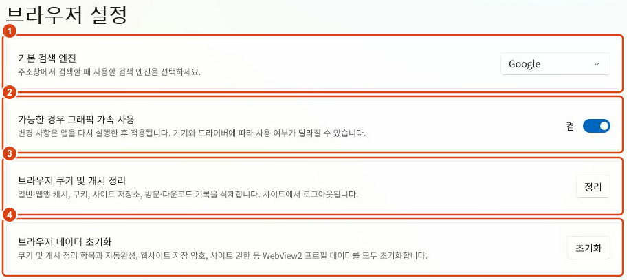

| 번호 | 설정 | 기능 |
| --- | --- | --- |
| 1 | 기본 검색 엔진 | 주소창에 검색어를 입력했을 때 사용할 서비스를 선택합니다. Google·Bing·Naver·Daum을 지원합니다. |
| 2 | 가능한 경우 그래픽 가속 사용 | 그래픽 가속 사용 여부를 정합니다. 변경 후 앱을 다시 실행해야 적용됩니다. |
| 3 | 브라우저 쿠키 및 캐시 정리 | 캐시, 쿠키, 사이트 저장소, 방문·다운로드 기록을 정리합니다. 사이트에서 로그아웃됩니다. |
| 4 | 브라우저 데이터 초기화 | 위 항목에 더해 자동완성, 웹사이트 저장 암호, 사이트 권한 등 브라우저 프로필 데이터를 모두 초기화합니다. |

정리·초기화는 **진행 중인 브라우저 작업을 중단하고 빈 페이지로 이동한 뒤** 수행합니다. 로그인이나 입력 중인 작업을 먼저 마치세요. 삭제한 브라우저 데이터는 되돌릴 수 없습니다.

여기서 말하는 웹사이트 저장 암호는 브라우저에 저장된 암호입니다. **계정 설정에 등록한 계정을 삭제하는 버튼은 아닙니다.**

검색 엔진·그래픽 가속 선택을 포함한 설정값은 앱을 다시 실행해도 유지됩니다.

## 부가기능

**설정 → 부가기능**에서 마우스 가두기와 창 전환을 확인할 수 있습니다.

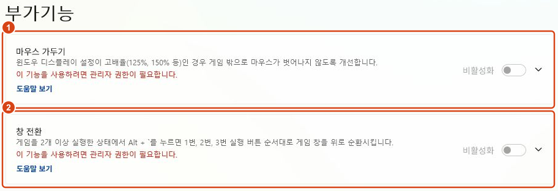

- **1 — 마우스 가두기:** Windows 배율을 사용하는 환경에서 마우스가 게임 창 밖으로 벗어나는 문제를 줄이는 기능입니다.
- **2 — 창 전환:** 게임을 여러 개 실행했을 때 **Alt + 백틱(역따옴표)**으로 게임 창을 순환하는 기능입니다. 백틱은 일반적으로 숫자 1 왼쪽의 키입니다.

**2.1.1에서는 이 두 부가기능에 관리자 권한이 필요하며, 일반 실행 상태에서는 비활성화됩니다.** 사용하려면 아래의 [관리자 권한 실행](#관리자-권한-실행) 방법으로 앱을 다시 실행하세요. 게임 설치·패치·다클라 생성과는 별개의 제한입니다.

### 관리자 권한 실행

1. 실행 중인 거상스테이션을 **완전히 종료**하세요. 트레이에 숨겨져 있다면 트레이 아이콘을 우클릭한 뒤 **종료**를 선택하세요.
2. 키보드의 **Windows 키**를 누르고 **거상** 또는 **GersangStation**을 검색하세요.
3. 검색 결과에서 **거상스테이션**을 선택하세요.

   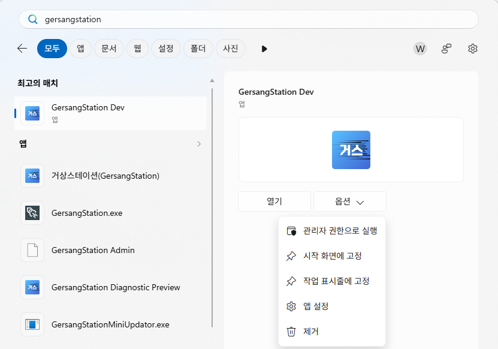

   화면은 개발용 앱 예시입니다. 스토어에서 설치한 **거상스테이션(GersangStation)**을 선택하면 됩니다.

4. 그림처럼 오른쪽의 **옵션 → 관리자 권한으로 실행**을 누르세요.
5. Windows의 사용자 계정 컨트롤 창에서 **예**를 선택하세요. 관리자 계정 정보를 요구하면 해당 정보를 입력하세요.
6. 앱이 다시 열리면 **설정 → 부가기능**에서 사용할 기능을 켜세요.

일반 권한으로 실행 중인 앱을 먼저 종료해야 관리자 권한으로 새로 실행할 수 있습니다. 시작 메뉴에서 앱을 평소처럼 열거나 Windows 시작 자동 실행으로 실행하면 일반 권한으로 열립니다. 부가기능을 사용할 때는 위 방법으로 실행하세요.

## 문제 해결과 도움말

- **현재 게임 버전을 확인할 수 없다면:** 선택한 서버의 설치 경로가 올바른지 확인하세요.
- **최신 버전 확인에 실패했다면:** 네트워크 연결을 확인한 뒤 새로고침으로 다시 확인하세요.
- **이벤트·공지사항 로딩이 실패했다면:** 해당 영역 가운데의 다시 불러오기 버튼을 누르세요.
- **로그인이 실패했다면:** 안내 내용을 확인하고 계정 정보나 홈페이지 접속 상태를 점검하세요.
- **예상하지 못한 오류가 발생했다면:** 오류 안내에 **상세 정보**가 제공되는 경우 해당 기록을 확인하고 문의에 함께 첨부하세요. 아이디 등 개인정보가 포함되었는지 먼저 확인하세요.

추가 설명이나 문의 방법은 홈의 **도움이 필요하신가요?** 타일 또는 [Q&A](https://github.com/byungmeo/GersangStation/wiki/Q&A)에서 확인할 수 있습니다.

앱 버전별 변경 사항은 홈의 **패치노트 보러가기** 타일 또는 [거상스테이션 패치노트](https://github.com/byungmeo/GersangStation/wiki/거상스테이션-패치노트)를 참고하세요.
